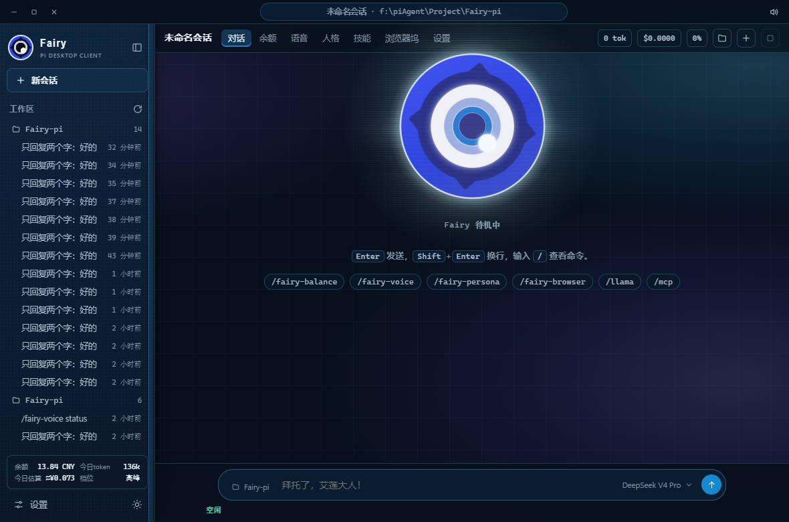
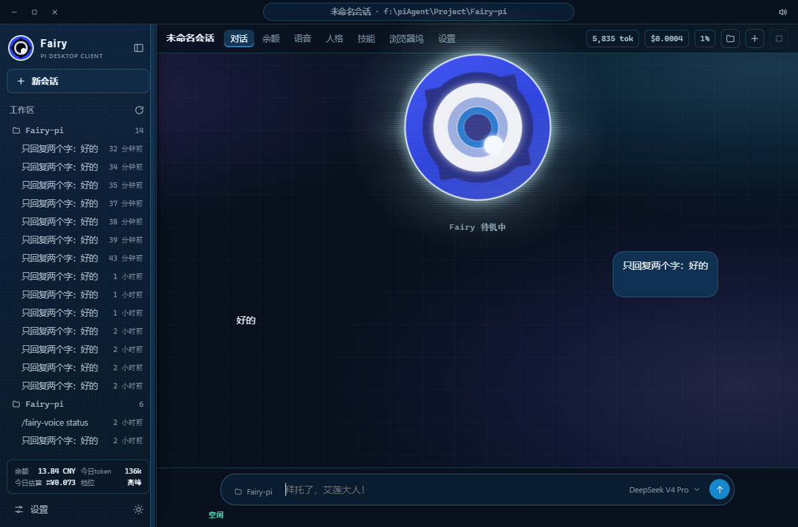
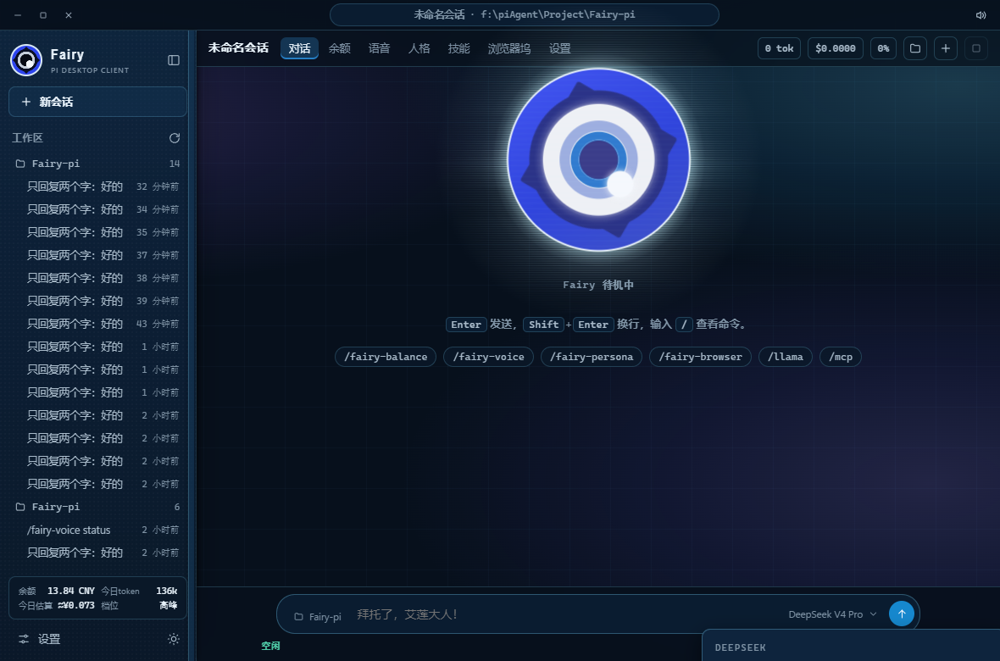
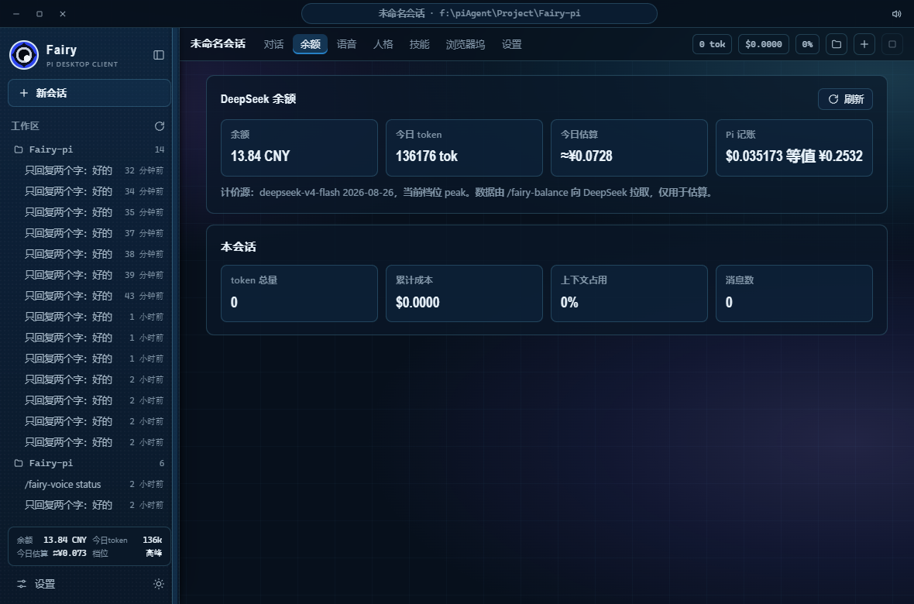
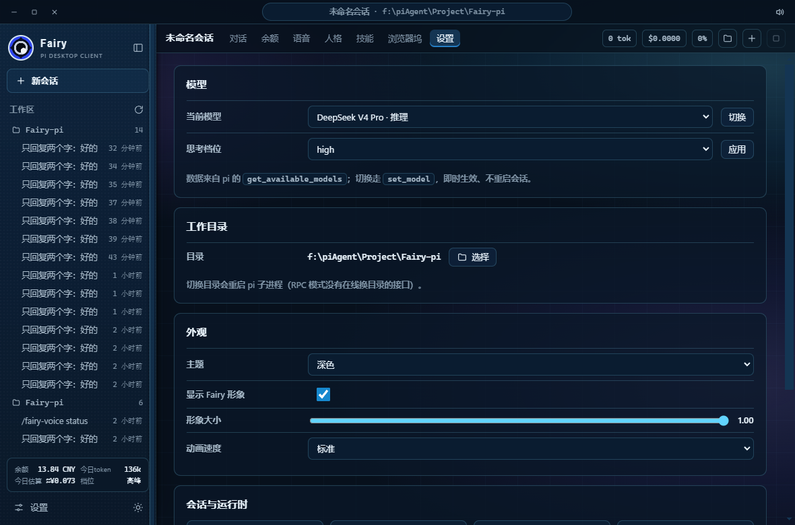
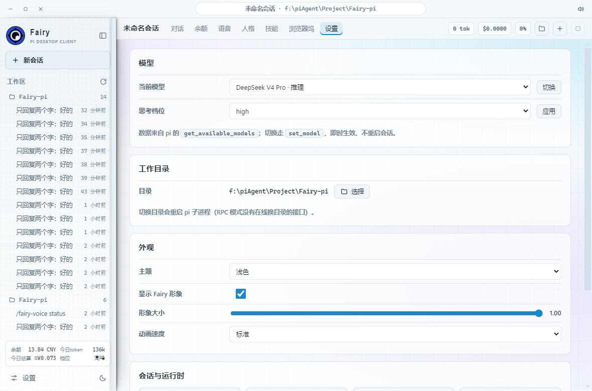
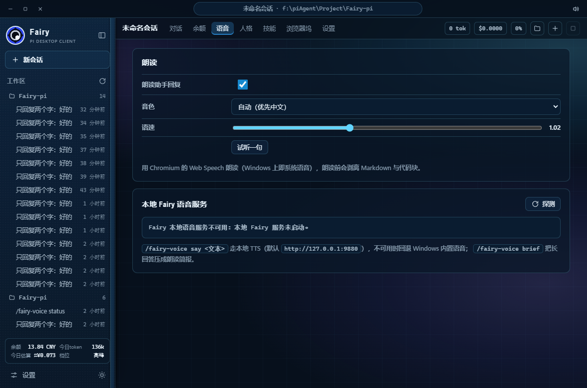
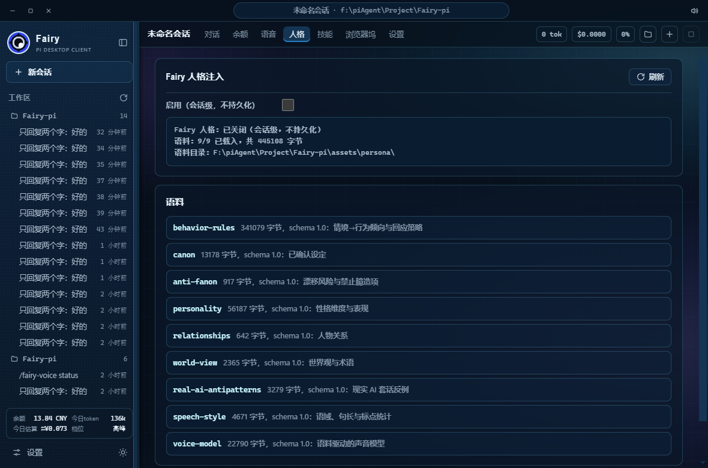
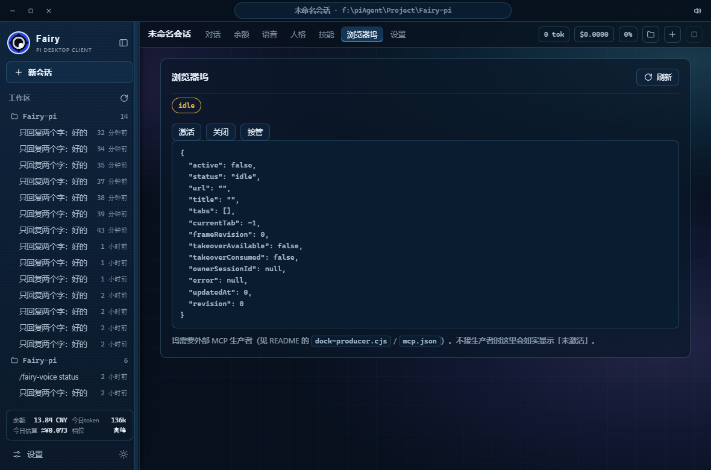

# Fairy-pi

把 [Fairy-DSH](https://github.com/Chengzhibense/Fairy-DSH) 的 Fairy 能力**适配**到 [Pi](https://pi.dev)（`@earendil-works/pi-coding-agent`）上的扩展包。不是复制文件：DSH 的宿主接口在 Pi 上不存在，每一个都换成了 Pi 的等价机制，并尽量让数值与文本口径与上游保持一致。

## 与上游的关系

| 上游（DSH / Cordis） | 本包（Pi） | 说明 |
|---|---|---|
| `webServer.register({path, handler})` | 无对应物 | Pi 扩展**不能注册 HTTP 端点**，一律改为命令 + 状态行 + 文件协议 |
| `ctx.on('session/event')` | `pi.on()` + [信号映射表](src/adapters/pi-events.ts) | 13 条归一化信号（`session:start`、`turn:end`…） |
| `ctx.effect(fn, label)` | [会话作用域](src/adapters/pi-lifecycle.ts) | `session_start` 建资源、`session_shutdown` 逆序幂等拆除 |
| `settings.register(ns, schema)` | [描述符表 + 注册表](src/adapters/pi-settings.ts) | Pi 的 `settings.json` 是固定 schema，装不下自定义命名空间 |
| `.credentials.yaml` 明文读密钥 | 宿主凭据接口注入 | 本包**不读密钥文件、不落日志、不写返回值** |
| `DSH_HOME`（`~/.dsh`） | `FAIRY_PI_DATA_DIR` 或 `~/.fairy-pi` | 运行时不写 pi 的 `agent_data` |
| `control-token` HTTP 鉴权 | 删除 | 没有 HTTP 写入面，留一个无用途的密钥文件只会误导 |
| `cordis.patch.yml` 注入 MCP | `pi.registerMcpServer()` | 默认不注册，是否引入浏览器自动化由使用方决定 |

## 安装

```bash
# 单次试载，不写 settings
pi -e /path/to/Fairy-pi

# 本地安装（会写 settings.json）
pi install /path/to/Fairy-pi
```

本包**没有**运行时依赖 `@earendil-works/*`（只有 `import type`），宿主包不存在重复实例问题。唯一的运行时依赖是朗读文本管线用的三个 mdast/micromark 包。

## 桌面端（双击即用）

`desktop/` 是一个 Electron 外壳：**双击 `Fairy-pi.exe` 就得到 pi 的图形界面**。它不实现自己的 agent——窗口里的对话由一个受管子进程 `pi --mode rpc` 承担，走 pi 官方的 JSONL 协议（`docs/rpc.md`、`rpc-commands.md`、`json.md`、`rpc-extension-ui.md`）。

```bash
cd desktop
npm install
npm start          # 开发态启动（自动先重建 Fairy 形象包）
npm run package    # 打包 → ../out/Fairy-pi-win32-x64/Fairy-pi.exe
```

界面照着 Fairy-DSH 客户端（其实体是 DeepSeek Harness 的 web 客户端）重做：**无边框窗口自带标题栏**（左侧窗口按钮 + 中间一条类似地址条的会话/目录 pill + 右侧朗读按钮），**左侧边栏是工作区而不是功能列表**，功能入口放在主区顶部的标签行。配色直接取上游的 `--dsw-alias-*` 令牌（深色 + 浅色两套），背景复刻它的 HDD 细网格与三团径向辉光。下面的截图全部来自**打包出来的 `Fairy-pi.exe`**（e2e 自动采集，不是示意图）。

- **侧边栏**：Fairy 眼形品牌标记 + 收起按钮 + 「新会话」+ 「工作区」会话树 + 底部余额卡 + 「设置」行。会话树按**工作目录分组**，每组可折叠并显示条数，会话行显示标题与相对时间（刚刚 / N 分钟前 / N 小时前），当前会话高亮；点一行即 `switch_session` 切过去，并用 `get_messages` 把历史重新渲染出来。数据来自主进程直接读取 `<agent_data>/sessions/**/*.jsonl`（pi 没有列出会话的 RPC 命令）。
- **余额卡**：DSH `sidebar.footer.action` 那张卡的两行四格布局——余额 / 今日 token / 今日估算 / 峰谷档位，窄栏里用 `1.38M`、`≈¥0.072` 这种紧凑写法；启动时自动跑一次 `/fairy-balance` 填入，不需要输命令。
- **顶部标签行**：会话名 + 对话 / 余额 / 语音 / 人格 / 技能 / 浏览器坞 / 设置，右侧是本会话用量与目录、新会话、中断。
- **模型切换**：输入区右侧的模型 chip 点开就是按 provider 分组的菜单（模型名 + 推理标签 + 上下文窗口），点击走 `set_model` **热切换**，不重启会话；设置页另有下拉 + 「思考档位」（`get_available_thinking_levels` / `set_thinking_level`）。
- **输入区**：一个药丸容器——左边工作目录 chip，中间输入框，右边模型 chip 与圆形发送按钮；`/` 仍弹出命令面板。
- **消息排版**：不再是带边框的卡片，而是浮在背景上——用户消息右对齐浅蓝气泡，助手回复纯文本，悬停出现复制按钮，thinking 收成一行 `Think`。
- **Fairy 形象**：固定为背景层，居中悬在会话区上方（`--mascot-zone` 预留它的高度，文案与消息都排在它下方，永不重叠）。直接复用 Fairy-DSH 的 `fairy-visual` 低层绘图模块（几何、眼睛/光晕 SVG、样式表），**原样再分发、未改动**；由 [`build-mascot.mjs`](desktop/scripts/build-mascot.mjs) 打成一个浏览器可用的 IIFE 挂载。待机动画来自这些模块自带的 CSS 关键帧，不需要上游的 `mascot-runtime.js`。
- **其余页面**：余额页四张指标卡 + 计价源注脚；语音页（朗读开关/音色/语速/试听 + 本地 TTS 探测）；人格页（注入开关 + 语料清单）；技能页（技能与扩展命令两组）；浏览器坞页（状态 + 激活/关闭/接管 + 原始 JSON）；设置页（模型、思考档位、工作目录、外观、会话与运行时）。
- **外观**：深色/浅色两套主题、形象显示开关、大小与动画速度（速度直接写上游的 `--dsh-fairy-steady-rate`）。
- **扩展 UI**：实现了 `extension_ui_request` 的 `notify` / `setStatus` / `setWidget` / `setTitle` / `set_editor_text` 与四类对话框，扩展的提示能落到界面上。

桌面端的窗口偏好（主题、朗读音色与语速、形象开关/大小/速度、侧边栏收起状态）存在渲染层 `localStorage`，不写 pi 的配置。

### 界面

<table>
  <tr>
    <td width="50%" align="center"><br><sub>欢迎态：左栏是工作区与会话树，底部余额卡，形象居中</sub></td>
    <td width="50%" align="center"><br><sub>对话态：用户右对齐气泡、助手纯文本、形象作为背景层</sub></td>
  </tr>
  <tr>
    <td width="50%" align="center"><br><sub>模型切换：按 provider 分组，当前模型高亮，点了即时生效</sub></td>
    <td width="50%" align="center"><br><sub>余额页：余额 / 今日 token / 今日估算 / Pi 记账 + 计价源注脚</sub></td>
  </tr>
  <tr>
    <td width="50%" align="center"><br><sub>设置页：模型、思考档位、工作目录、外观</sub></td>
    <td width="50%" align="center"><br><sub>浅色主题：同一套令牌的另一半</sub></td>
  </tr>
  <tr>
    <td width="50%" align="center"><br><sub>语音页：朗读开关、音色、语速、本地 TTS 探测</sub></td>
    <td width="50%" align="center"><br><sub>人格页：注入开关、状态、语料清单</sub></td>
  </tr>
  <tr>
    <td width="50%" align="center"><br><sub>技能页：技能与扩展命令两组，点「使用」填入输入框</sub></td>
    <td width="50%" align="center"><br><sub>浏览器坞：状态、激活/关闭/接管、原始状态 JSON</sub></td>
  </tr>
</table>

**`pi` 的位置如何找到**：`FAIRY_PI_AGENT_DIR` → `%LOCALAPPDATA%\Programs\pi-agent\agent_data` → PATH 上的 `pi` 启动器 → 各盘符的 `\Users\<你>\AppData\Local\Programs\pi-agent\agent_data`。装在非系统盘时靠最后一条兜底。可用 `FAIRY_PI_AGENT_DIR` / `FAIRY_PI_CLI` / `FAIRY_PI_NODE` / `FAIRY_PI_WORKDIR` 覆盖。

**明确不做什么**：不起 HTTP 服务、不监听端口（`--remote-debugging-port` 只在自动化测试时由测试脚本传入）、不驱动 DSH、不碰 DeepSeek Harness。

```bash
cd desktop
npm test           # 静态检查 + 形象包实机求值 + pi 定位 + 外壳接线
npm run test:e2e   # 真开窗口：切页面、开模型菜单、填空拍提交、断言回复与用量
                   # 设 FAIRY_PI_E2E_SCREENSHOT_DIR 还会把 docs/ 里那批截图重新采一遍
```

## 打包与发布

已打包的 `out/` 不进仓库（`.gitignore` 挡着），分发走 GitHub Releases。

### 出一个可分发的单文件

```bash
cd desktop
npm install
npm run package      # → ../out/Fairy-pi-win32-x64/
npm run release:zip  # → ../out/Fairy-pi-win32-x64.zip（约 110 MB）
```

### 方式一：手动传到 Release（不需要任何 CI）

1. 打开 <https://github.com/TaotaoByte/Fairy-pi/releases> → `Draft a new release`
2. `Choose a tag` 里填 `v0.1.0`，选 `Create new tag`（目标分支选 `main`）
3. 把 `out/Fairy-pi-win32-x64.zip` 拖进附件区，写两句说明，`Publish release`

### 方式二：打个 tag，交给 GitHub Actions 自动发布

仓库里已带 [`.github/workflows/release.yml`](.github/workflows/release.yml)：推送 `v*` 标签即触发 `windows-latest` 上的 `npm ci` → `npm test` → 打包 → 压缩 → 挂到同名 Release（release notes 自动生成）。

```bash
git tag v0.1.0
git push origin v0.1.0
```

本机若装了 `gh`，也可以不用 CI，一条命令直接传：

```bash
gh release create v0.1.0 out/Fairy-pi-win32-x64.zip --title "Fairy-pi v0.1.0" --generate-notes
```

### 下载的人需要知道什么

- 解压后双击 `Fairy-pi.exe`。**它本身不是 agent**——窗口里的对话由**本机的 `pi`** 承担，所以对方机器上得先装 pi（`npm i -g @earendil-works/pi-coding-agent` 或它自带的安装器），并且 pi 里要有可用的 provider 与凭据。
- 找不到 pi 时不会静默失败：底部状态写「未找到 pi」并弹提示；可用 `FAIRY_PI_AGENT_DIR` / `FAIRY_PI_CLI` / `FAIRY_PI_NODE` / `FAIRY_PI_WORKDIR` 指路。
- 未做代码签名，Windows SmartScreen 可能拦一次（「更多信息」→「仍要运行」）。

## 命令

| 命令 | 子命令 | 作用 |
|---|---|---|
| `/fairy-balance` | — | DeepSeek 余额 + 当日用量与费用估算（含峰谷档位） |
| `/fairy-voice` | `status` | 探测本地语音服务（默认 `http://127.0.0.1:9880`） |
| | `say <文本>` | 合成音频并写出可播放的 WAV；本地 TTS 不可用时回退到 Windows 内置语音 |
| | `brief <Markdown>` | 把长回答压成适合朗读的中文简报 |
| `/fairy-persona` | `on` / `off` | 开关人设注入（**默认关闭**，会话级、不持久化） |
| | `status` / `digest` / `corpus` / `reload` | 查看语料状态、预览将注入的段落、列出语料路径 |
| `/fairy-browser` | `state` / `frames` | 浏览器坞状态与帧文件 |
| | `bind` / `close` / `takeover <revision>` | 写控制命令（takeover 需状态允许） |
| | `mcp` | 查看 MCP 注册情况 |

## 前置条件与默认行为

- **数据目录**：`FAIRY_PI_DATA_DIR`，否则 `~/.fairy-pi/`。日账、参考音频、合成音频、浏览器坞状态都在这里。
- **本地 TTS**：`http://127.0.0.1:9880` 后端未部署时，`/fairy-voice status` 会**如实报「未启动」**——这是上游本地服务缺失时的既有行为，不是缺陷。参考音频放 `<数据目录>/fairy-voice/runtime/reference/fairy_ref.wav`（提示词同目录 `fairy_ref.txt`，缺失则退化为上游的固定文案）。
  `say` 不会因此变成死路：本地 TTS 失败时自动改用 **Windows 内置语音**（`System.Speech`）朗读，通知里写清「这不是 Fairy 的音色」。这是本包新增的回退（上游没有），只为让没有 9880 后端的机器也能出声；`speechFallback: false` 可关掉。文本走临时文件传入而不拼进 `-Command`，避免引号与注入。
- **人格注入**：默认关闭。`/fairy-persona on` 后，通过 `before_agent_start` 的 `systemPromptOptions.sections` 注入**有上界**的人设 + 语料摘要，不整体替换 `systemPrompt`。
- **浏览器坞**：本包**自带生产者** [`dock-producer.cjs`](src/features/browser/dock-producer.cjs)——一个与具体 MCP 无关的 stdio 代理：把请求/响应逐行原样转发，观察 `tools/call` 发布状态，**任何工具结果里的图片**都落成 `frame-<revision>.jpg`，并按 `<数据目录>/browser-dock/command.json` 处理 `bind`/`close`/`takeover`。接法二选一：

  ```jsonc
  // 方式一（推荐，走 Pi 自带的 MCP 支持；`pi mcp list` 可验证）
  // ~/.pi/agent/mcp.json
  {
    "mcpServers": {
      "browser-dock": {
        "command": "node",
        "args": [
          "<本包路径>/src/features/browser/dock-producer.cjs",
          "npx", "@playwright/mcp@latest"
        ]
      }
    }
  }
  ```

  ```powershell
  # 方式二（由本扩展注册；需要 Pi 内置 MCP 支持来建立连接）
  $env:FAIRY_PI_BROWSER_MCP_ARGS = '["npx","@playwright/mcp@latest"]'
  ```

  不接任何 MCP 时，`/fairy-browser state` 会如实显示「未激活」——文件契约本身是可用的，缺的只是生产者。第二个参数起就是目标 MCP 命令，换成任何 MCP 都行。

## 已验证口径

移植不是「看起来一样」，而是逐项对照过：

- 诊断日志：同一批输入，与上游 `fairy-contracts/diagnostics.js` 输出**逐行逐字节相同**。
- 计费：把上游的 `tokenCount` + 单价表 + 两个函数原样抽出来执行，709 项结果**bit 级相等**（覆盖整周 ×15 分钟的峰谷网格）。
- 朗读文本管线：3 个函数 × 34 组输入 + 31 组组合管道，共 **134 项完全一致**。

部分「怪」结果是**上游原样行为**（`第二句!` 半角标点、`负 负二百七十三点一五` 重复、千分位逗号转全角），测试里专门断言它们，防止后来者顺手优化而破坏一致性。

实机验证（pi 1.0.4）：`pi --mode json -p` 跑通，入口加载、四个功能的会话作用域建立、`message_end` 的用量累计真实写入 `<数据目录>/balance-meter-daily.json`；Windows 内置语音实测发声成功（本机装有三套 SAPI 语音）。

浏览器坞生产者：4 项集成测试真的起两个进程（代理 + 假 MCP）用 JSON-RPC 驱动，覆盖透明转发、任意图片落帧、工具名/参数命中人机验证、`takeover`/`close` 与收场清理；另有 2 项入口测试覆盖 `FAIRY_PI_BROWSER_MCP_ARGS` 的解析与注册。

**桌面端**：先用一个探针脚本确认 `pi --mode rpc` 的握手（`get_state` / `get_commands` / `get_session_stats` / `get_available_models` 均正常返回、关 stdin 后干净退出），并实测 `set_model` 能热切换（切到 `deepseek-flash` 后 `get_state` 跟着变），然后对**打包出来的 `Fairy-pi.exe`** 跑了端到端：CDP 把它当用户操作——点侧边栏切页、开模型菜单、按 Esc 关闭、填输入框、派发提交、轮询界面——**42 项全部通过**（含欢迎态、对话态、余额页、设置页、语音页、人格页、技能页、浏览器坞页、模型菜单、浅色主题共十张截图落盘），其中窗口标题为 `Fairy-pi · pi 1.0.4`、模型 chip 显示 `DeepSeek V4 Pro`、顶栏 7 个标签页、侧边栏会话树按 6 个工作区分组、标题栏 pill 显示「会话名 · 工作目录」、余额卡自动填成 `13.85 CNY`、设置页列出 12 个模型、模型菜单 12 行且当前模型高亮、用户消息与助手回复都在屏上、`agent_settled` 后运行态回「空闲」、用量累计到 `5,835 tok`。Fairy 形象确实挂载（`[data-dsh-fairy-mascot-root="true"]`），子进程确认为 `node.exe <pi cli.js> --mode rpc`。

**一条几何断言**：欢迎态曾出现文案压在形象上的问题（形象是固定背景层，而 `#messages` 也预留了同一块高度，页面因此可滚动、把文案顶了上去）。现在 e2e 直接断言 `文案顶边 ≥ 形象底边` 并打印两者的坐标，改坏了会当场失败，而不是靠人眼看截图。

**命令名必须原样使用**：`get_commands` 里同名的两个命令，pi 会改名为 `fairy-voice:1` / `fairy-voice:2`（本机实测：`:1` 是旧的 pi-fairy 桌宠包，`:2` 是本包；那之后已用 `pi remove "G:\AI_Project\pi-fairy"` 卸掉旧包，现在本机只剩无后缀的 `fairy-voice`）。这两个后缀名才是可派发的命令——把后缀去掉得到的 `/fairy-voice` 不是命令，pi 会**把它当普通输入交给模型**（实测回包 `disposition: "started"`，模型开始翻目录找这个技能）。所以命令面板与欢迎态 chips 一律显示 `get_commands` 给出的原始名字，不做美化。

**桌面端的三个真实缺陷**（都是实机跑出来的，不是推演）：一是 `path.join('F:', 'Users')` 会得到盘符相对的 `F:Users`，导致装在非系统盘时定位不到 pi；二是 PATH 分支多剥了一层目录，把 `agent_data` 丢了；三是按「去后缀」去重命令名，产出了派发不了的假命令。三处都已修，前两处加了不依赖 Electron 的定位单测，第三处改为一律原样显示；另修掉一个纯视觉问题——空输入框上多余的滚动条。

**一处未在本机验证**：`pi --mode json -p` 这次运行里，扩展注册的 MCP 服务器没有留下连接痕迹（`~/.pi/agent/mcp.log` 不存在，生产者也没启动）。所以我没把「方式二」写成已验证——请用交互式 pi 的 `/mcp` 或 `pi mcp list` 确认；「方式一」的 `mcp.json` 是 Pi 自带 MCP 支持直接读取的路径，可先用 `pi mcp list` 验证条目本身。

**跨平台修正**：Windows 上 `rename` 覆盖正被打开的目标会瞬时失败（`EPERM`/`EACCES`/`EBUSY`），而消费者经常在轮询同一个文件。三处落盘（日账、坞状态、坞命令）现在统一走带退避重试的原子替换——这个缺陷是测试轮询状态文件时暴露出来的，不修就会静默丢一次写入。

**估算口径的注意点**：单价表来自上游，只覆盖 `deepseek-v4-flash`。若会话用的是别的模型（例如默认的 `deepseek-v4-pro`），`/fairy-balance` 的「费用估算」是按 flash 单价推算的值，会与 Pi 自己的记账不一致——`Pi 记账` 那一行就是为此显示的。

## 目录结构

```text
Fairy-pi/
├── index.ts                 入口：只做装配
├── src/
│   ├── contracts/           契约层：日志 schema、脱敏、词汇表
│   ├── adapters/            DSH 接口 → Pi 机制的语义映射
│   └── features/
│       ├── balance/         费用估算、日账、余额查询
│       ├── voice/           朗读文本管线、本地 TTS、语音简报
│       ├── persona/         人设正文与语料摘要
│       └── browser/         浏览器坞文件协议与观察
├── skills/fairy-persona/    人格技能（SKILL.md）
├── assets/persona/          上游语料（Apache-2.0，未改动内容）
├── desktop/                 Electron 桌面前端（见上节）
│   ├── src/main.cjs         主进程：进程管理、RPC 桥、会话索引、窗口控制
│   ├── src/pi-locate.cjs    pi 定位（可独立测试）
│   ├── src/preload.cjs      contextBridge 白名单
│   ├── src/renderer/        界面（index.html / styles.css / app.js）
│   ├── docs/                e2e 采集的界面截图（README 里引用）
│   ├── vendor/fairy-mascot/ Fairy-DSH 形象模块原样副本
│   └── scripts/             build-mascot / smoke / e2e / package / zip
├── .github/workflows/       release.yml：打 tag 自动打包并发布
└── tests/                   94 项扩展测试
```

## 开发

```bash
npm test              # 全部测试
npm run test:voice    # 单个模块
```

测试不依赖 Pi 进程：适配层与功能层都能用假的 `ExtensionAPI` 桩驱动，因此可以直接 `node --experimental-strip-types --test` 跑。

## 许可与来源

Apache-2.0。上游作品来源、被移植/再分发的内容清单、以及**未移植**的部分见 [NOTICE](NOTICE)。

值得说明的缺口：上游 `.agent-presets/fairy/runtime/{index.js, fairy_core.py, safety-gate.js}` 在公开仓库中**不存在**，所以语料驱动的检索内核无法移植；本包以「语料随包分发 + 有上界摘要 + 技能按需读取全文」作为可验证的降级方案。

本包不含 [pi-fairy](https://github.com/ymd-physics/pi-fairy) / pi-fairy-win 的任何内容——形象绘制复用 Fairy-DSH 的模块，桌面外壳是本包自己的 Electron 外壳，与 pi-fairy 不共享代码。若两者同时装在同一个 pi 上，同名命令会被 pi 改名为 `fairy-voice:1` / `:2`（见上节）；只想留一个时用 `pi remove pi-fairy` 卸掉旧桌宠包。
